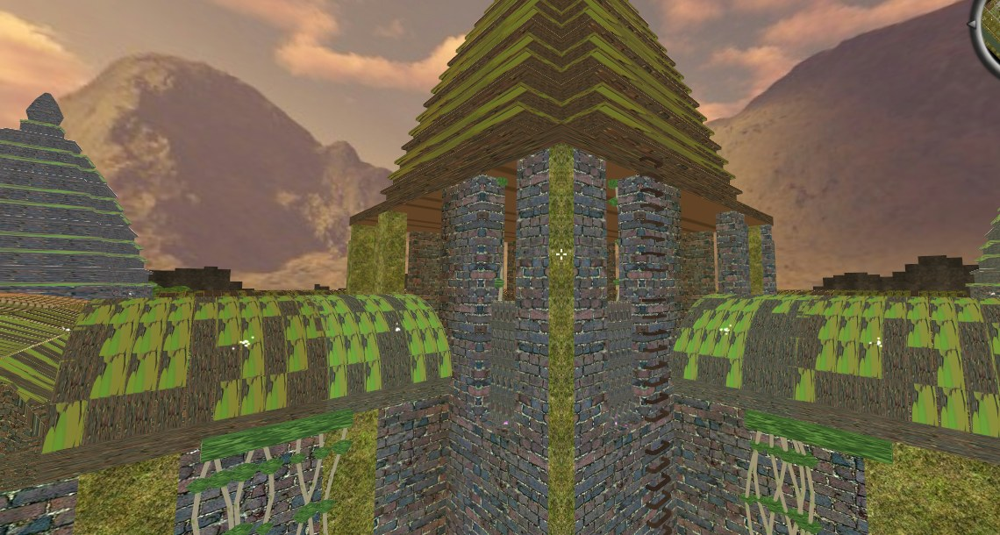
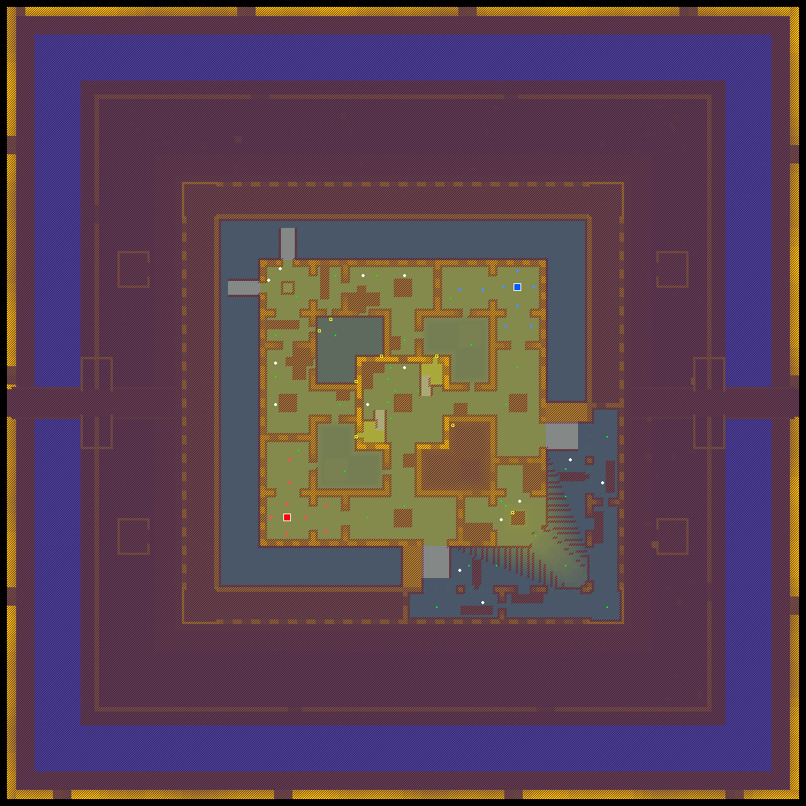
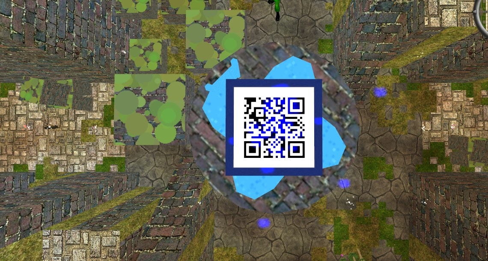
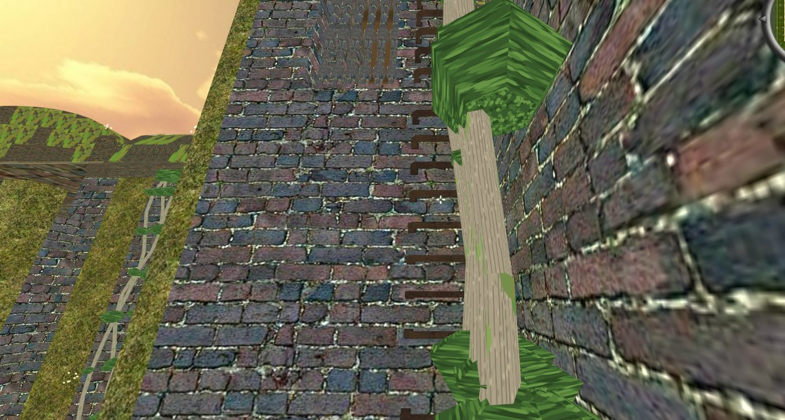

# cl_angkorwat — Angkor Wat temple CTF for AssaultCube

A capture-the-flag map for [AssaultCube](https://assault.cubers.net/) 1.3, set in the ruins of a Khmer
temple. Made for the [cubeLadder](https://cubeladder.ovh) community.



The map was not drawn in the editor: it is **generated by a Python script** (`src/gen_wat.py`),
including its own 3D models (prang roofs, vaulted hallways, nagas, strangler figs, the cubeLadder
logo). Change a number, run the script, play the new version.

## Install

1. Copy `maps/cl_angkorwat.cgz` into `packages/maps/` of your AssaultCube folder
   (on Linux usually `~/.assaultcube/v1.3/packages/maps/`).
2. Unzip `packages/cubeladder_khmer_pack.zip` into `packages/models/mapmodels/`
   so that you get `packages/models/mapmodels/cubeladder/khmer/…`.
3. In the game: console, `mode 5` (CTF), then `map cl_angkorwat`.

Every player needs the model pack: a server only sends the `.cgz`. Without the pack the roofs, vaults
and other models are simply not drawn, while their collision boxes still block.

## The map

- 512 grid; the playable temple is 192 × 192 cells, the moat, lawns and outer wall are scenery.
- Both bases are on the 2nd floor: red in the south-west pagoda, blue in the north-east one. Blue's
  side is red's mirrored across the diagonal, so the map is fair.
- Three lanes between the bases: through the courtyards, cross hallways and the great hall; over the
  north-west pagoda; or down to the 1st floor and back up the stairs.
- The great hall has two balconies behind baluster windows (the sniper spots), ladders lead onto the
  roofs and up the great prang, stone ledges climb to a platform on the great pillar.
- 8 spawns per team plus 14 neutral ones, 33 pickups, flags 141 cells apart.





## Build it yourself

Needs Python 3 with Pillow and an AssaultCube 1.3 install (some model textures are taken from it):

```bash
cd src
AC_DIR=/path/to/AssaultCube python3 gen_wat.py ../maps/cl_angkorwat.cgz
```

This writes the map and the model pack folder (`src/models/cubeladder/khmer`) and checks the layout:
both teams reach both flags, every item is reachable, nobody can leave the temple.

| File | What it does |
|---|---|
| `src/gen_wat.py` | the map: layout, walls, stairs, ladders, models, lights, spawns, items |
| `src/acmap.py` | reads and writes AssaultCube `.cgz` map files (format 10) |
| `src/builder.py` | building blocks: open areas, walls, ramps, pillars, mirrored for CTF |
| `src/models.py` | MD3 map models built in code, with a painted texture atlas |
| `src/plan.py` | top-down floor plan and the walkability check |

## Licence

- The map, the model pack and the images: [CC BY-SA 4.0](https://creativecommons.org/licenses/by-sa/4.0/)
  (`LICENSE`).
- The Python code: MIT (`src/LICENSE`).
- Two textures in the model atlas are copies of AssaultCube's default textures: `grsites/brick065`
  (from grsites.com, free for personal and commercial use) and `boeck/wood_010` (royalty free, by Boeck,
  boeckmania.de). The map itself uses AssaultCube's default textures and sounds, which come with the game.


